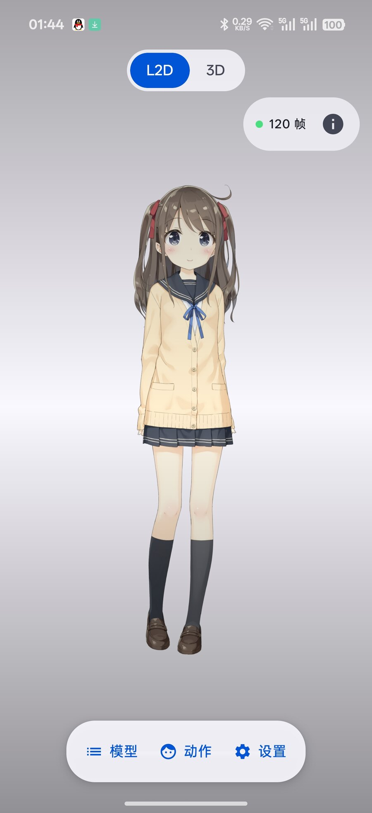
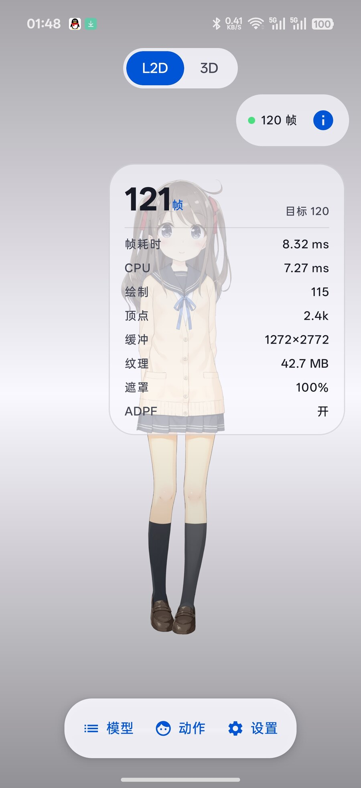
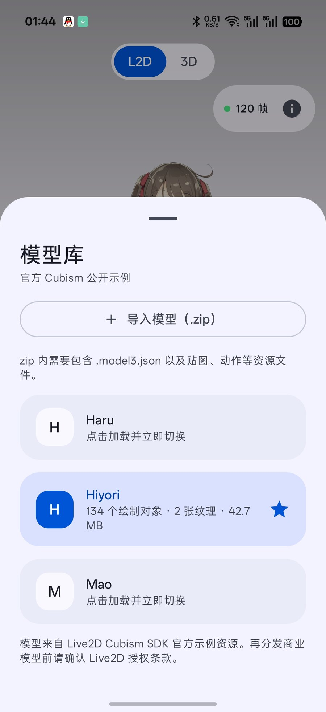
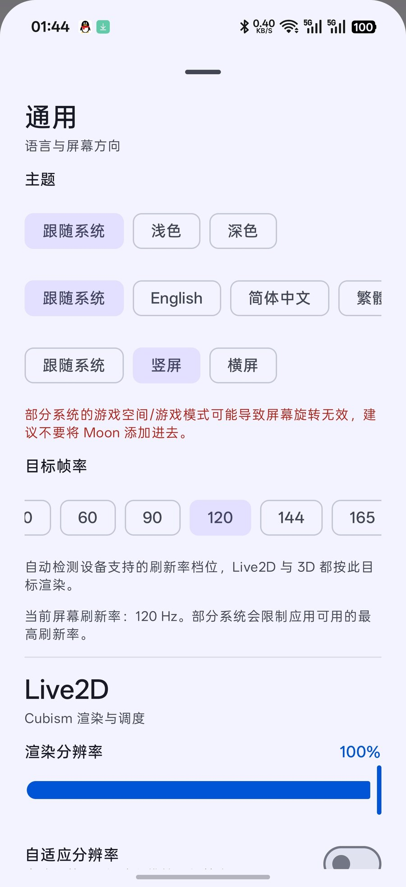
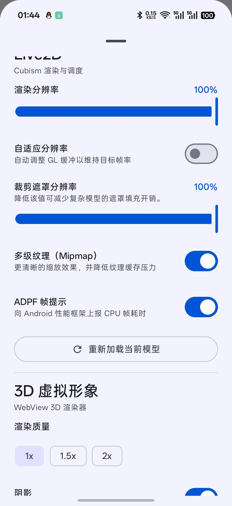

<p align="center">
  
</p>

<h1 align="center">Moon</h1>

**Android Live2D & VRM Avatar Viewer**  
一个面向 Live2D 与 VRM / GLB 虚拟形象的 Android 浏览器，使用 Material 3 Expressive 构建。

> 非官方项目，与 Live2D Inc.、VRM Consortium、VRChat 或任何模型作者无隶属关系。

---

## 功能

- **Live2D Cubism 5 原生渲染**
  - 官方 Cubism Native SDK / OpenGL ES 渲染器
  - 动作、表情、物理、呼吸、眨眼、视线跟随
  - 双指捏合缩放模型（0.5x–3.0x）
  - 长按振动后单指拖动模型位置
  - 模型切换、参数重置、动作随机播放
- **VRM / GLB 3D 形象**
  - three.js + `@pixiv/three-vrm`
  - WebView 内离线渲染，支持 VRM 0.x / VRM 1.0 / GLB
  - MToon 材质、SpringBone、LookAt、基础待机动作
- **模型导入**
  - Live2D：导入包含 `.model3.json` 的 zip
  - 3D：导入单文件 `.vrm` / `.glb`
  - 导入后保存在应用私有目录，自动刷新模型列表
- **统一 UI（2D / 3D 共用）**
  - Material 3 Expressive：动态取色、表达性动效、悬浮工具栏
  - 深浅色 / 跟随系统主题
  - 简体中文、繁体中文、English、日本語、한국어
  - 2D / 3D 共用顶部状态、性能卡和设置面板
- **性能选项**
  - 目标帧率、渲染分辨率、裁剪遮罩分辨率
  - 自适应分辨率、Mipmap、ADPF
  - Surface `setFrameRate` + 显示模式请求
  - 可选 Root 性能模式（CPU/GPU governor）
  - 可选 Root 强制刷新率（SurfaceFlinger 显示模式）
- **兼容性**
  - `minSdk 28`（Android 9）
  - `targetSdk 36`
  - `compileSdk 37`
  - 支持 `arm64-v8a` 与 `x86_64`

---

## 截图

<p align="center">
  
  
  
</p>

<p align="center">
  
  
</p>

---

## 快速开始

### 环境要求

- JDK 17
- Android SDK Platform 37
- Android NDK `27.2.12479018`
- CMake 3.22+
- 官方 **Live2D Cubism SDK for Native 5-r.5**

### 放置 Live2D SDK

本仓库不分发 Cubism Core / Cubism Native SDK。请从 Live2D 官方获取并遵守其许可证：

```text
sdk/
└── CubismSdkForNative-5-r.5/
    ├── Core/
    ├── Framework/
    └── Samples/
```

也可以通过环境变量指定：

```bash
export LIVE2D_SDK=/path/to/CubismSdkForNative-5-r.5
```

### 构建

```bash
git clone https://github.com/Winkmoon/android-live2d-vrm-viewer.git
cd android-live2d-vrm-viewer

# 配置 Android SDK
echo "sdk.dir=/path/to/android-sdk" > local.properties

./gradlew assembleDebug
```

APK 输出：

```text
app/build/outputs/apk/debug/app-debug.apk
```

> 在 aarch64 Linux / Termux 环境构建时，Android SDK 自带的 CMake 可能是 x86_64 二进制。可以安装宿主 CMake/Ninja，并在 `local.properties` 中设置 `cmake.dir=/usr`。

---

## 使用方式

### 导入 Live2D 模型

1. 将模型目录打包为 zip
2. zip 内必须包含 `.model3.json`
3. 打开 Moon → 底部「模型」→「导入模型」
4. 选择 zip，应用会解压到私有目录并刷新模型列表

推荐 zip 结构：

```text
MyModel/
├── MyModel.model3.json
├── MyModel.moc3
├── MyModel.physics3.json
├── textures/
└── motions/
```

### 2D 手势

| 手势 | 操作 |
| --- | --- |
| 单指拖动 | 视线跟随 / 模型互动 |
| 单击 | 触发模型动作或表情 |
| 双指捏合 | 放大或缩小模型，范围 0.5x–3.0x |
| 长按后拖动 | 触发短振动，进入模型位置移动模式；松手结束 |

### 导入 VRM / GLB

1. 打开 3D 模式
2. 底部「模型」→「导入 VRM / GLB」
3. 选择单文件 `.vrm` 或 `.glb`

当前不支持：

- `.gltf` + 外部 `.bin` / 贴图目录
- FBX
- Unity `.unitypackage`
- VRChat `.vrca`

---

## 架构

```text
app/src/main/java/com/winkmoon/xinran/
├── MainActivity.kt          # 单 Activity 入口
├── MoonApp.kt               # 主题与统一壳
├── UnifiedViewerApp.kt      # 2D/3D 共用 UI 与设置
├── Live2DApp.kt             # Live2D 内容区
├── Live2DView.kt            # GLSurfaceView / 帧率 / 动态分辨率
├── Live2DNative.kt          # JNI 声明
├── Avatar3DActivity.kt      # 3D 内容区与 WebView
├── Avatar3DWebView.kt       # WebViewAssetLoader / JS bridge
├── RootTuner.kt             # 可选 Root 性能模式
├── RootRefreshRateForcer.kt # 可选 Root 刷新率强制
├── RootShell.kt             # Root 命令后端
├── UnifiedSettings.kt       # 统一设置面板
└── Theme.kt                 # M3E 主题

app/src/main/cpp/            # Cubism OpenGL 示例改造 + JNI
web3d/                       # three.js / three-vrm 查看器源码
fetch_cubism.py              # Live2D SDK 下载辅助
```

### 渲染路径

- **2D**：`GLSurfaceView` GL 线程 → Cubism Native → OpenGL ES 2.0
- **3D**：`WebView` + `WebViewAssetLoader` → three.js / three-vrm → WebGL
- **UI**：Jetpack Compose 覆盖在内容区之上，2D/3D 共用同一套 Chrome

---

## 性能说明

- Live2D 使用独立 GL 渲染线程
- 支持动态分辨率、Mipmap、裁剪遮罩缓冲缩放
- 支持 ADPF（`PerformanceHintManager`）向系统报告实际 CPU 帧耗时
- Root 性能模式会尝试写入 CPU/GPU governor，退出时恢复原值
- Root 强制刷新率会通过 SurfaceFlinger `1035` 直接切换显示模式，退出时恢复

### 注意事项

- Root 功能完全可选；不授予 Root 时应用正常运行
- 不同厂商可能限制普通应用的刷新率，实际值以系统为准
- **游戏空间 / 游戏模式可能限制屏幕旋转或刷新率**，建议不要将 Moon 加入游戏空间
- Root 命令使用统一的 `RootShell`，支持 `su -c`、自定义前缀以及 `{cmd}` 占位符

---

## 已知限制

- 3D 模式依赖 WebView WebGL2；极老或精简系统可能不可用
- 仅支持单文件 VRM / GLB，不支持完整 glTF 外部资源目录
- 未实现 VRM 表情 / VRMA 动作编辑 UI
- 示例模型、Cubism Core 与第三方模型资产不随仓库分发
- 不同 OEM 的刷新率 / 游戏空间策略可能导致行为差异

---

## 外部资源

以下文件/项目不随本仓库分发，请从官方来源获取并遵守各自许可证：

| 资源 | 链接 | 用途 |
| --- | --- | --- |
| Live2D Cubism SDK for Native | https://www.live2d.com/en/sdk/download/native/ | Live2D 原生渲染 SDK / Core |
| Live2D 官方示例模型 | https://www.live2d.com/en/learn/sample/ | Cubism 示例模型资源 |
| three.js | https://threejs.org/ | WebGL 3D 渲染 |
| @pixiv/three-vrm | https://github.com/pixiv/three-vrm | VRM 加载与渲染 |
| Material 3 | https://m3.material.io/ | UI 设计系统 |
| Jetpack Compose | https://developer.android.com/compose | Android UI |
| Android NDK | https://developer.android.com/ndk | Native 构建 |

## 第三方组件与许可证

本项目代码采用 **Apache-2.0**，见仓库根目录的 `LICENSE`。

以下组件/资产有独立许可证，不能仅凭本项目许可证分发：

- **Live2D Cubism SDK / Core**：Live2D Inc. 许可，需自行下载并遵守官方条款
- **Live2D 官方示例模型**（Hiyori / Haru / Mao 等）：按官方 SDK 资源条款使用
- **three.js**：MIT
- **@pixiv/three-vrm**：MIT
- 用户导入的模型、贴图、动作：归原作者所有，仓库不附带授权

公开发布 APK 或仓库前，请确认：

1. 不提交 `sdk/`、`local.properties`、构建产物
2. 不提交未获授权的模型 / 贴图 / 动作
3. 在 README 和 About 中保留第三方许可证声明
4. 不把项目描述为 Live2D 官方产品

---

## 贡献

欢迎提交 Issue 和 Pull Request。

提交前建议：

```bash
./gradlew assembleDebug
```

并说明：

- 设备型号 / Android 版本
- 2D 或 3D 模式
- 是否启用 Root / 游戏空间
- 复现步骤与日志

---

## 致谢

- [Live2D Cubism SDK](https://www.live2d.com/)
- [three.js](https://threejs.org/)
- [@pixiv/three-vrm](https://github.com/pixiv/three-vrm)
- Material 3 Expressive / Jetpack Compose
- 所有公开模型作者与测试设备贡献者

---

## 感谢

感谢 Live2D Inc. 提供 Cubism SDK，感谢 three.js 与 @pixiv/three-vrm 社区提供开源 3D/VRM 渲染能力，感谢 AndroidX / Jetpack Compose / Material 3 团队，也感谢所有公开模型作者、测试者和开源社区贡献者。

Moon 是非官方项目，所有第三方名称、模型与资源版权归其各自作者所有。

